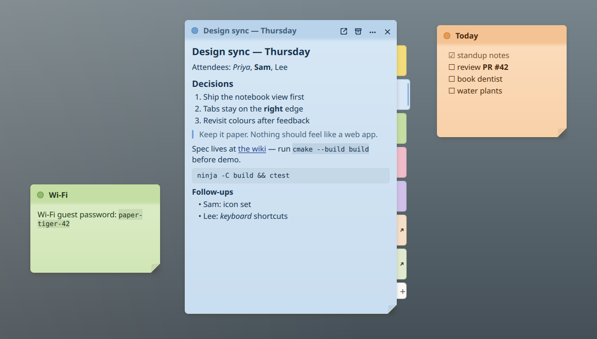

<div align="center">


# Sticky Notes

**Fast Markdown sticky notes for the KDE Plasma desktop.**

A notebook with tabs down the side, notes you can peel off and stick anywhere on any screen,
and every note stored as a plain Markdown file.



</div>

## Features

- **Notebook with side tabs:** one coloured tab per note down the right edge, and a **+** tab for a
  new one. Drag the tabs to reorder them.
- **Pop notes onto the desktop:** peel a note off the notebook and it becomes its own little sticky
  note. Drag it anywhere, including onto another monitor. Its position, size and screen are saved.
- **Pin or sit on the desktop:** a popped-out note sits on the desktop layer, below your windows, by
  default. Pin it to keep it above everything.
- **Markdown:** headings, lists, **bold**/*italic*, links, `code`, code blocks, quotes, and
  clickable task-list checkboxes (`- [ ]`). Click a note to edit the raw text and press Escape to
  see it rendered again.
- **Plain files you own:** each note is a `.md` file with YAML front matter. Edit the files in
  another editor and the app picks up the changes live.
- **Archive, don't delete:** archiving only sets `archived: true` in the file. Deleting moves the
  file to a `.trash/` folder; nothing is ever unlinked.
- **Built for speed:** native C++/Qt Quick. Saves are debounced, atomic and off the typing path. The
  app does nothing when idle. The first frame takes about 50 ms with 100 notes.
- **Tray icon and start on login**, a single running instance, and seven paper colours.
- **Wayland first:** desktop notes use `wlr-layer-shell` (LayerShellQt) on Plasma Wayland, and fall
  back to frameless tool windows on X11.

## Install

### Build from source

You need CMake ≥ 3.21, a C++20 compiler and Qt ≥ 6.6 (Core, Gui, Qml, Quick, QuickControls2,
Widgets, Network). [LayerShellQt](https://invent.kde.org/plasma/layer-shell-qt) is optional but
recommended on Wayland.

On Ubuntu 26.04 or Kubuntu:

```sh
sudo apt install cmake ninja-build g++ qt6-base-dev qt6-base-dev-tools qt6-declarative-dev \
    qt6-declarative-dev-tools qt6-wayland-dev liblayershellqtinterface-dev \
    qml6-module-qtquick qml6-module-qtquick-controls qml6-module-qtquick-layouts \
    qml6-module-qtquick-templates qml6-module-qtquick-window qml6-module-qtqml-workerscript
```

On Arch:

```sh
sudo pacman -S --needed cmake ninja qt6-base qt6-declarative qt6-wayland layer-shell-qt
```

Then:

```sh
git clone https://github.com/clankercode/plasma-markdown-sticky-note.git
cd plasma-markdown-sticky-note
cmake -S . -B build -G Ninja -DCMAKE_BUILD_TYPE=Release
cmake --build build
ctest --test-dir build --output-on-failure   # optional
sudo cmake --install build                   # or --prefix ~/.local
```

This installs the `sticky-notes` binary, a desktop entry, an AppStream metainfo file and the icon.
Launch it as **Sticky Notes** from the app launcher.

#### Build options

| Option | Default | Meaning |
|---|---|---|
| `STICKY_NOTES_WITH_LAYERSHELL` | `ON` | Use LayerShellQt for desktop notes on Wayland, if found |
| `STICKY_NOTES_BUILD_TESTS` | `ON` | Build the unit and integration tests |
| `STICKY_NOTES_BUILD_APP` | `ON` | `OFF` builds only the core library tests |

## Usage

```
sticky-notes [--notes-dir <path>] [--minimized] [--new]
```

| Flag | |
|---|---|
| `--notes-dir <path>` | Use another notes folder. The `STICKY_NOTES_DIR` environment variable does the same. |
| `--minimized` | Start with the notebook hidden; desktop notes are still shown. Autostart uses this. |
| `--new` | Create a new note. If the app is already running, the running copy creates it. |

Running `sticky-notes` again while it's already running just brings the notebook forward.

The tray icon menu has New note, Show notebook, Show/Hide desktop notes, **Start on login**, and Quit.
Closing the notebook hides it to the tray.

### Keyboard shortcuts

| Keys | Action |
|---|---|
| `Ctrl+N` | New note |
| `Ctrl+W` | Archive current note |
| `Ctrl+Shift+P` | Pop the current note out onto the desktop |
| `Ctrl+Tab` / `Ctrl+PgDown` | Next note |
| `Ctrl+Shift+Tab` / `Ctrl+PgUp` | Previous note |
| `Escape` | Stop editing (show the rendered Markdown) |
| `Ctrl+Q` | Quit |

## File format

Notes live in `~/.local/share/sticky-notes/notes/` (`$XDG_DATA_HOME/sticky-notes/notes`), one
file per note:

```markdown
---
id: 20261117-163455-a1b2
title: Groceries
color: yellow
created: 2026-11-17T16:34:55+11:00
modified: 2026-11-17T16:40:02+11:00
archived: false
order: 3
popped_out: true
pinned: false
screen: DP-1
x: 120
y: 80
width: 280
height: 260
---
- [ ] milk
- [x] eggs
```

| Key | Meaning |
|---|---|
| `id` | Stable id. The filename (`<id>.md`) is the source of truth. |
| `title` | Optional. If empty, the first line of the body is used. |
| `color` | `yellow`, `pink`, `green`, `blue`, `purple`, `orange` or `gray` |
| `created`, `modified` | ISO-8601 timestamps. `modified` changes when the content changes. |
| `archived` | Archived notes are hidden from the tabs but kept on disk |
| `order` | Tab position in the notebook |
| `popped_out` | Shown as a separate note on the desktop |
| `pinned` | A popped-out note stays above windows |
| `screen`, `x`, `y`, `width`, `height` | Where the popped-out note sits, relative to that screen |

Every key is optional, and a plain `.md` file with no front matter is a valid note. **Keys the app
doesn't know about, comments and formatting are kept exactly as they are**, so you can add your own
metadata.

### Data safety

- Writes are atomic: a temporary file is renamed into place, so a crash can't leave a half-written note.
- Typing is saved about 400 ms after you stop, and always on quit, logout and `SIGTERM`/`SIGINT`.
- If a note can't be saved (for example, the disk is full), quitting is blocked and you're offered a
  retry or a recovery copy. The recovery copy goes in `~/.local/share/clankercode/sticky-notes/recovery/` (or the temp folder
  if that isn't writable).
- If you change a file elsewhere while the app has no unsaved edits for that note, it reloads the
  file. If there are unsaved edits, your in-app version wins and is saved.

## Development

```sh
cmake -S . -B build -G Ninja -DCMAKE_BUILD_TYPE=Debug
cmake --build build && ctest --test-dir build --output-on-failure
```

- `src/core/`: front-matter parser/serialiser, `Note`, `NoteStore` (persistence and file watching),
  and `NoteListModel`. It has no UI dependencies and is fully unit-tested.
- `src/app/`: `main`, `AppController` (tray, settings, autostart), `DesktopPlacement` (layer-shell
  and X11 placement, dragging across screens), `MarkdownStyler`, and `SingleInstance`.
- `src/qml/`: the UI. The QML is compiled ahead of time with qmlcachegen.
- `STICKY_NOTES_QUIT_AFTER_FIRST_FRAME=1` prints the startup time to first frame and exits, which is
  handy for benchmarking.

## License

[MIT](LICENSE) © 2026 clankercode contributors
